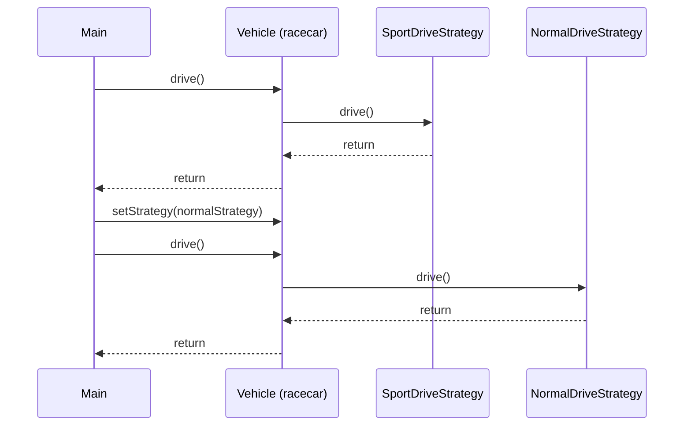

# Strategy Design Pattern

> Behavioral Design Pattern | Java 21

## 1. Introduction

The Strategy Design Pattern defines a family of algorithms or behaviors, encapsulates each one separately, and makes them interchangeable. It allows behavior to vary independently of the object that uses it.

## 2. Problem Statement

Design a vehicle system in which different vehicles can use different driving behaviors, such as normal driving and sports driving. A vehicle should also be able to change its driving behavior at runtime without modifying its class.

Using inheritance alone could lead to duplicated behavior across vehicle subclasses or an increasing number of subclasses for different behavior combinations.

## 3. Solution

Define a common `DriveStrategy` interface and encapsulate each driving behavior in a separate implementation. The `Vehicle` class holds a reference to the interface and delegates driving to the selected strategy.

The client selects the initial strategy through the constructor and can replace it using `setStrategy()` at runtime.

## 4. UML Class Diagram



## 5. Participants

| Component | Pattern role | Responsibility |
| --- | --- | --- |
| `DriveStrategy` | Strategy | Defines the common driving contract. |
| `NormalDriveStrategy` | Concrete Strategy | Implements normal driving behavior. |
| `SportDriveStrategy` | Concrete Strategy | Implements sports driving behavior. |
| `Vehicle` | Context | Stores the selected strategy and delegates driving to it. |
| `Main` | Client | Creates vehicles, selects strategies and demonstrates runtime switching. |

## 6. Execution Flow

1. Create a truck with `NormalDriveStrategy`.
2. Create a racecar with `SportDriveStrategy`.
3. Call `drive()` on both vehicles; each delegates to its current strategy.
4. Change the racecar's strategy to `NormalDriveStrategy` using `setStrategy()`.
5. Call `drive()` again to demonstrate that the same vehicle now behaves differently.



## 7. Expected Output

```text
Truck starts: Normal Driving
Racecar starts: Sports Driving
Racecar used as a passenger car:
Racecar(normal mode) starts: Normal Driving
```

Run `Main.java` from IntelliJ IDEA to execute the demonstration.

## 8. Design Principles Applied

- **Open/Closed Principle:** New driving behaviors can be added by implementing `DriveStrategy` without modifying `Vehicle`.
- **Dependency Inversion Principle:** The context depends on an abstraction instead of concrete driving implementations.
- **Single Responsibility Principle:** Each strategy encapsulates its own driving behavior, while the context delegates to the selected strategy.
- **Composition over inheritance:** Behavior is supplied through an object reference rather than vehicle subclass hierarchies.
- **Dependency injection:** The strategy is supplied through constructor and setter injection.

## 9. Advantages and Limitations

| Advantages | Limitations |
| --- | --- |
| Supports runtime behavior switching. | Introduces additional classes or strategy objects. |
| Reduces duplication of driving behavior. | The client must know which strategy to select. |
| Makes strategies independently testable. | May be unnecessary for a single, fixed behavior. |
| Supports extension without modifying the context. | Mutable strategy selection requires care in concurrent environments. |

The current example assumes non-null strategies and single-threaded execution. Null validation can be added using `Objects.requireNonNull()` if needed.

## 10. When to Use

Use Strategy when multiple interchangeable implementations of a behavior are needed, especially when the behavior must be selected or changed at runtime. Common examples include payment methods, sorting algorithms, pricing rules and route selection.

## 11. Interview Takeaway

Strategy separates **what an object does** from **how it does it**. The context delegates behavior to an interchangeable strategy instead of implementing every possible behavior itself.
