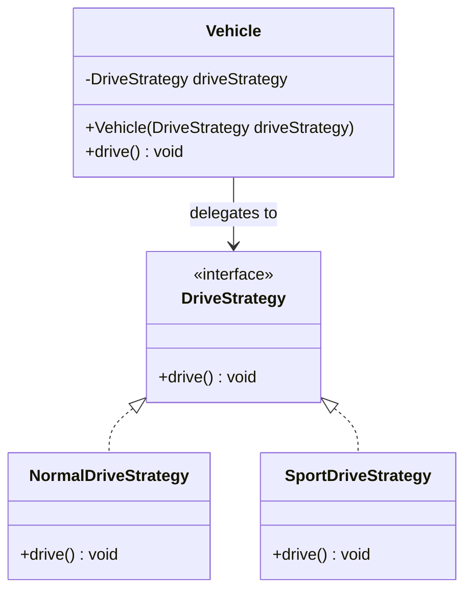

# Strategy Design Pattern

**Category:** Behavioral Design Pattern

## 1. Introduction

The Strategy Pattern defines a family of algorithms, encapsulates each one separately, and makes them interchangeable through a common interface.

In simple terms, an object delegates a particular behavior to another object instead of implementing every possible variation itself.

**Core idea:** Favor composition over inheritance for varying behavior.

## 2. Problem Statement

Consider a vehicle system with normal, sports and off-road vehicles. Sports and off-road vehicles may share the same specialized driving behavior.

Without the Strategy Pattern, subclasses may override `drive()` with duplicate logic, or a central class may use growing conditional blocks to select behavior.

This makes shared behavior harder to maintain and new variations harder to introduce.

## 3. Solution

- Extract varying driving behaviors into separate strategy classes.
- Define a common `DriveStrategy` interface.
- Let `Vehicle` hold a reference to a strategy and delegate `drive()` to it.
- Supply the appropriate strategy when creating a vehicle.

Different vehicles can reuse the same strategy without duplicating its implementation. New strategies can be introduced without modifying the existing context.

## 4. UML Class Diagram



`Vehicle` has a strategy (HAS-A relationship). Concrete strategies implement the common interface. The context does not need to know how each strategy performs its operation.

## 5. Key Components

| Component | Responsibility | Example |
|---|---|---|
| Strategy | Defines the common behavior | `DriveStrategy` |
| Concrete Strategy | Implements a specific behavior | `NormalDriveStrategy`, `SportDriveStrategy` |
| Context | Holds a strategy and delegates execution | `Vehicle` |
| Client | Selects and supplies a strategy | Calling code |

## 6. Example Implementation

A simplified Java example using constructor injection:

```java
interface DriveStrategy {
    void drive();
}

class NormalDriveStrategy implements DriveStrategy {
    public void drive() {
        System.out.println("Normal Driving");
    }
}

class SportDriveStrategy implements DriveStrategy {
    public void drive() {
        System.out.println("Sports Driving");
    }
}

class Vehicle {
    private final DriveStrategy driveStrategy;

    Vehicle(DriveStrategy driveStrategy) {
        this.driveStrategy = driveStrategy;
    }

    void drive() {
        driveStrategy.drive();
    }
}
```

**Example behavior:**

```java
new Vehicle(new NormalDriveStrategy()).drive();
new Vehicle(new SportDriveStrategy()).drive();
```

**Expected output:**

```text
Normal Driving
Sports Driving
```

Strategies can be selected at runtime through constructor injection. If an existing context must change its strategy after construction, a setter or another replacement mechanism can be provided.

## 7. SOLID Principles

| Principle | How it applies |
|---|---|
| SRP | Each strategy encapsulates a particular algorithm. |
| OCP | New strategies can be added without modifying the context. |
| LSP | Strategies are interchangeable when they honor the same contract. |
| ISP | A focused strategy interface avoids unrelated operations. |
| DIP | The context depends on an abstraction rather than concrete strategies. |

**Most relevant:** OCP and DIP.

## 8. Advantages and Disadvantages

| Advantages | Disadvantages |
|---|---|
| Reuses behavior across different objects | May introduce additional classes |
| Reduces algorithm-specific conditional logic | Client must know which strategy to select |
| Supports flexible behavior selection | Can be overengineering for simple, stable behavior |
| Allows strategies to be tested independently | May require additional context or parameters |

## 9. When to Use

Use the Strategy Pattern when multiple interchangeable algorithms perform the same general operation, behavior varies across objects, or algorithm-selection logic becomes difficult to maintain.

Common applications:

- Payment processing: UPI, card, net banking.
- Discount calculation: seasonal, membership, promotional discounts.
- Navigation: fastest, shortest or economical routes.
- Sorting: interchangeable comparison strategies.

Avoid introducing the pattern when a simple, stable implementation is sufficient.

## 10. Interview Questions

**Q1. Why prefer composition over inheritance here?**  
Composition allows unrelated objects to reuse behavior independently of their inheritance hierarchy.

**Q2. Strategy vs Factory Pattern?**  
Strategy determines how an operation is performed. Factory determines which object is created. A factory can also select a strategy.

**Q3. Does Strategy eliminate all conditional statements?**  
No. Selection logic may still exist, but individual algorithms are separated from that logic and from the context.

**Q4. Is a setter mandatory for Strategy Pattern?**  
No. Constructor injection is sufficient for selecting a strategy. A setter is useful only if an existing context needs to switch strategies.

**Q5. Can strategies be implemented using Java lambdas?**  
Yes, when the strategy interface is a functional interface.

## 11. Quick Revision

- **Pattern type:** Behavioral.
- **Problem:** Duplicate or tightly coupled varying behavior.
- **Solution:** Encapsulate interchangeable algorithms behind a common interface.
- **Relationship:** Context HAS-A Strategy.
- **Execution:** Client selects strategy; context delegates execution.
- **Key principles:** Composition over inheritance, OCP and DIP.

> Strategy Pattern allows an algorithm to vary independently of the clients that use it.
