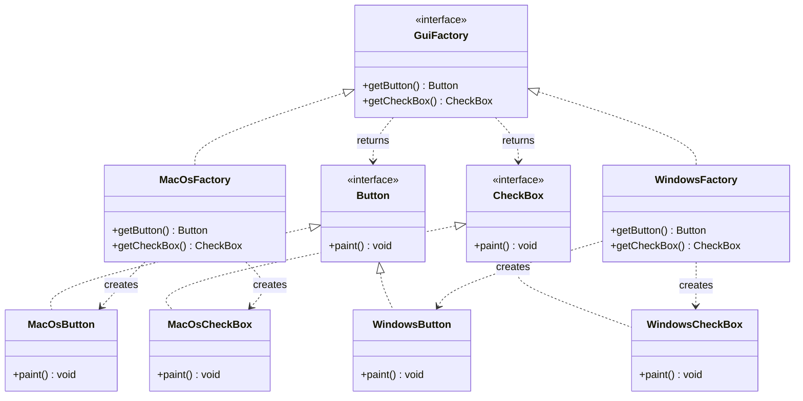
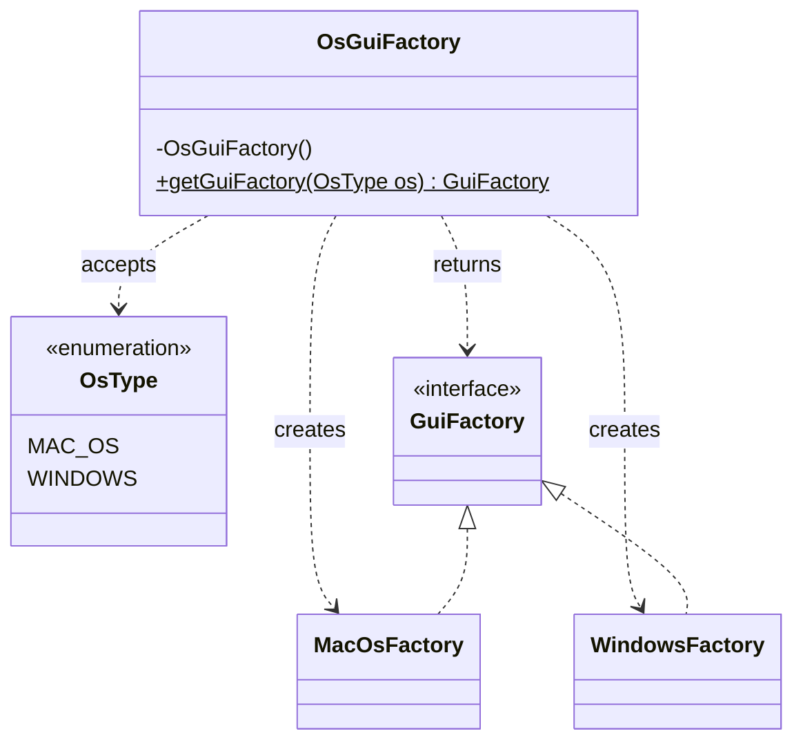
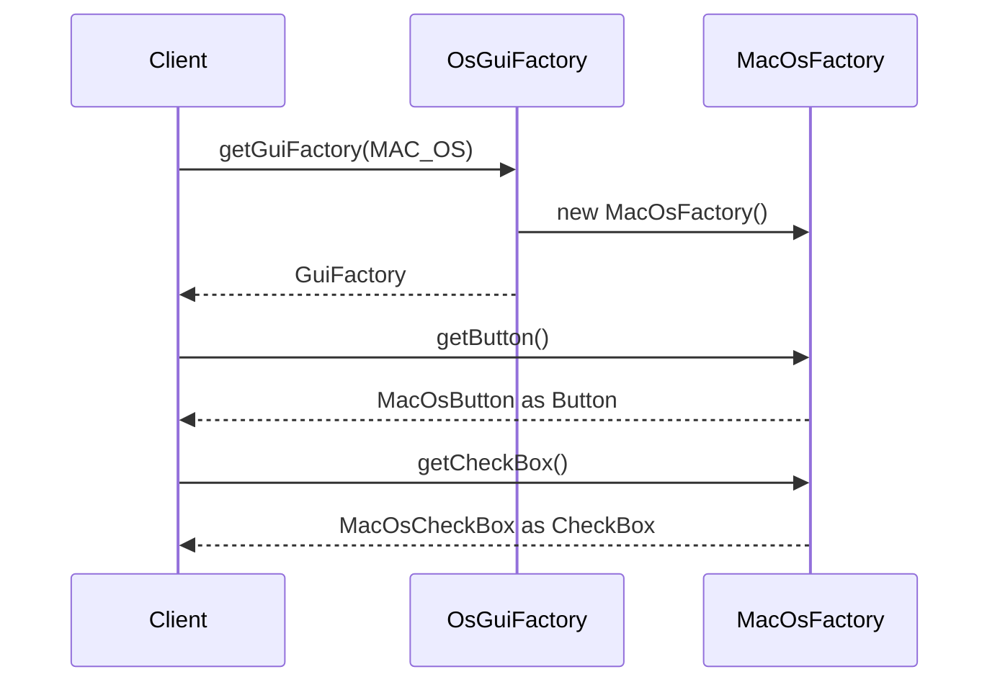

# Abstract Factory Design Pattern

**Category:** Creational (GoF)

## 1. Introduction

Abstract Factory provides an interface for creating families of related or dependent objects without specifying their concrete classes.

## 2. Problem Statement

A cross-platform GUI requires buttons and checkboxes for macOS and Windows. Directly creating concrete components couples clients to platform-specific classes and makes it easy to mix incompatible product families.

## 3. Solution

Define an interface for each product type and a factory interface exposing creation methods for all product types. Each concrete factory creates one consistent product family. The client selects a factory and uses its products through abstractions.

| Product | macOS family | Windows family |
|---|---|---|
| Button | MacOsButton | WindowsButton |
| CheckBox | MacOsCheckBox | WindowsCheckBox |
| Factory | MacOsFactory | WindowsFactory |

## 4. UML Class Diagram



### Factory selection (optional Simple Factory)



Splitting factory selection from the core diagram keeps the product-family relationships readable. Dashed hollow triangles denote interface realization; dashed arrows denote dependencies, including creation.

## 5. Participants

| Role | Responsibility |
|---|---|
| Abstract product | Defines the contract for a product type. |
| Concrete product | Implements a product for a specific family. |
| Abstract factory | Declares creation methods for related product types. |
| Concrete factory | Creates products belonging to one family. |
| Client | Uses factory and product abstractions. |
| Factory selector (optional) | Chooses a concrete factory using configuration or an enum. |

## 6. Illustrative Implementation

```java
public interface Button {
    void paint();
}

public interface CheckBox {
    void paint();
}

public interface GuiFactory {
    Button getButton();
    CheckBox getCheckBox();
}
```

```java
public class MacOsFactory implements GuiFactory {
    public Button getButton() {
        return new MacOsButton();
    }

    public CheckBox getCheckBox() {
        return new MacOsCheckBox();
    }
}
```

WindowsFactory implements the same contract using Windows products. Each concrete product implements its respective product interface.

An optional Simple Factory centralises platform selection (Java 21):

```java
public enum OsType {
    MAC_OS, WINDOWS
}

public class OsGuiFactory {
    private OsGuiFactory() {}

    public static GuiFactory getGuiFactory(OsType os) {
        return switch (os) {
            case MAC_OS -> new MacOsFactory();
            case WINDOWS -> new WindowsFactory();
            case null -> throw new IllegalArgumentException("OS type cannot be null");
        };
    }
}
```

The client can use the same logic for either family:

```java
GuiFactory factory = OsGuiFactory.getGuiFactory(OsType.MAC_OS);
factory.getButton().paint();
factory.getCheckBox().paint();
```

The selector uses recommended enum naming and a private constructor. An exhaustive enum switch needs no default branch. These snippets illustrate the design rather than reproduce every source file.

## 7. Execution Flow



## 8. Sample Output

```text
Apple MAC-OS
MacOS: Button Enabled
MacOS: CheckBox Marked
Microsoft WINDOWS
Windows: Button Enabled
Windows: CheckBox Marked
```

## 9. Design Principles

- **SRP:** Each concrete factory handles creation of its own family.
- **DIP:** Clients depend on abstract products and factories.
- **OCP:** New families can be introduced without changing existing product implementations or concrete factories; a central selector may still require modification.
- **LSP:** Concrete factories and products are interchangeable through their contracts, provided they preserve those contracts.
- **ISP:** Separate product interfaces expose only relevant operations.

## 10. Advantages and Limitations

**Advantages:** Consistent product families, centralised creation, reduced coupling and easier platform substitution.

**Limitations:** More interfaces and classes; adding a new product type requires changing the factory contract and all concrete factories. A central enum-based selector must also change when new families are introduced. Clients can still mix products from different factories if they deliberately do so.

## 11. When to Use

- Cross-platform GUI components.
- Related database-provider components.
- Theme-specific UI components.
- Families of compatible infrastructure adapters.

## 12. Interview Takeaways

| Pattern | Purpose |
|---|---|
| Simple Factory | Selects and creates a product using centralised logic. |
| Factory Method | Lets subclasses determine which product to create through an overridable creation method. |
| Abstract Factory | Creates families of related products through a common factory interface. |

Abstract Factory favours adding new families over adding new product types. A Simple Factory can select an Abstract Factory, but is not required by the pattern. An abstract factory can be a Java interface; it does not have to be an abstract class.

## Reference

[Factory and Abstract Factory — video reference](https://youtu.be/7g9S371qzwM?si=E9EO5Xjx4jwOd3Pg)
