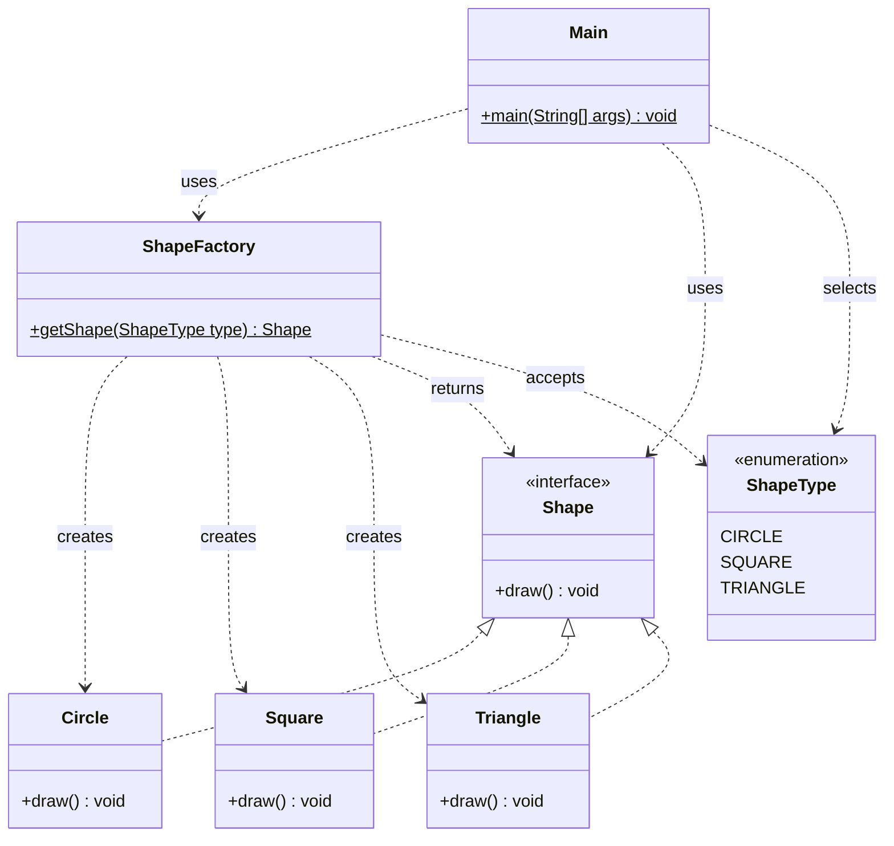
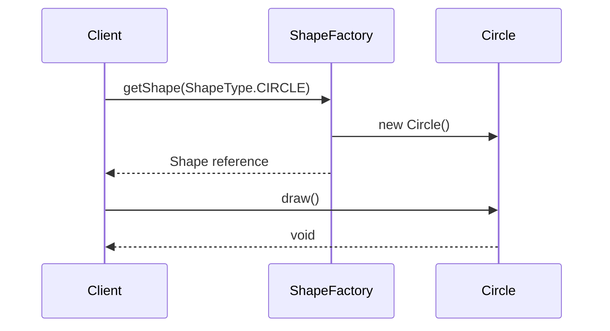

# Factory Design Pattern (Simple Factory)

**Category:** Creational

## 1. Introduction

A factory encapsulates object creation and returns products through a common abstraction. The client requests a product without needing to know its concrete construction logic.

## 2. Problem Statement

An application supports multiple shapes. If clients instantiate concrete shapes directly, creation logic becomes scattered and clients become coupled to concrete classes.

## 3. Solution

Define a common product interface, implement concrete products, and centralise product selection and creation in a factory. The client uses the returned abstraction.

## 4. UML Class Diagram



## 5. Participants

| Role | Responsibility |
|---|---|
| Product | Defines the common contract (`Shape`). |
| Concrete product | Implements product-specific behaviour (`Circle`, `Square`, `Triangle`). |
| Product type | Defines supported product choices (`ShapeType`). |
| Factory | Selects and creates a concrete product (`ShapeFactory`). |
| Client | Requests and uses products through their abstraction. |

## 6. Illustrative Implementation

```java
public interface Shape {
    void draw();
}
```

```java
public class Circle implements Shape {
    @Override
    public void draw() {
        System.out.println("Draw: Circle");
    }
}
```

Other concrete shapes implement the same interface.

```java
public enum ShapeType {
    CIRCLE, SQUARE, TRIANGLE
}
```

```java
public class ShapeFactory {
    public static Shape getShape(ShapeType type) {
        return switch (type) {
            case CIRCLE -> new Circle();
            case SQUARE -> new Square();
            case TRIANGLE -> new Triangle();
            case null -> throw new IllegalArgumentException("Shape type cannot be null");
        };
    }
}
```

The example uses Java 21, an enum for type-safe product selection, and fail-fast null validation. The exhaustive enum switch needs no default branch. The static factory method requires no factory instance because it maintains no instance state.

```java
ShapeFactory.getShape(ShapeType.CIRCLE).draw();
ShapeFactory.getShape(ShapeType.SQUARE).draw();
ShapeFactory.getShape(ShapeType.TRIANGLE).draw();
```

## 7. Execution Flow



### Sample Output

```text
Draw: Circle
Draw: Square
Draw: Triangle
```

## 8. Design Principles

- **SRP:** Separates product creation from product behaviour.
- **Abstraction and polymorphism:** Clients use a common product contract.
- **Loose coupling:** Clients need not directly instantiate concrete products.
- **OCP limitation:** Adding a product usually requires changing the factory's selection logic.

## 9. Advantages and Limitations

| Advantages | Limitations |
|---|---|
| Centralised creation logic | Factory may grow as product types increase |
| Reduced client coupling | Factory depends on concrete products |
| Consistent construction and validation | New products typically require factory changes |
| Type-safe enum selection | Static calls are harder to substitute in tests |

## 10. Simple Factory vs Factory Method

| Simple Factory | Factory Method (GoF) |
|---|---|
| Centralised selection logic | Creation delegated to an overridable method |
| Typically uses a switch or mapping | Typically uses creator subclasses and polymorphism |
| Not a formal GoF pattern | Formal GoF creational pattern |

Abstract Factory is another GoF pattern that creates families of related products without specifying their concrete classes.

## 11. Use Cases

- Selecting notification senders or parsers based on a requested type.
- Creating shapes, vehicles or payment handlers from predefined options.
- Centralising object construction and validation.

## 12. Interview Takeaway

Use a Simple Factory when object selection and construction should be centralised. Use Factory Method when creator subclasses should determine which product to instantiate. Returning an interface alone does not make a factory a GoF Factory Method.

## Reference

- [Factory Design Pattern — video reference](https://youtu.be/7g9S371qzwM?si=E9EO5Xjx4jwOd3Pg)
