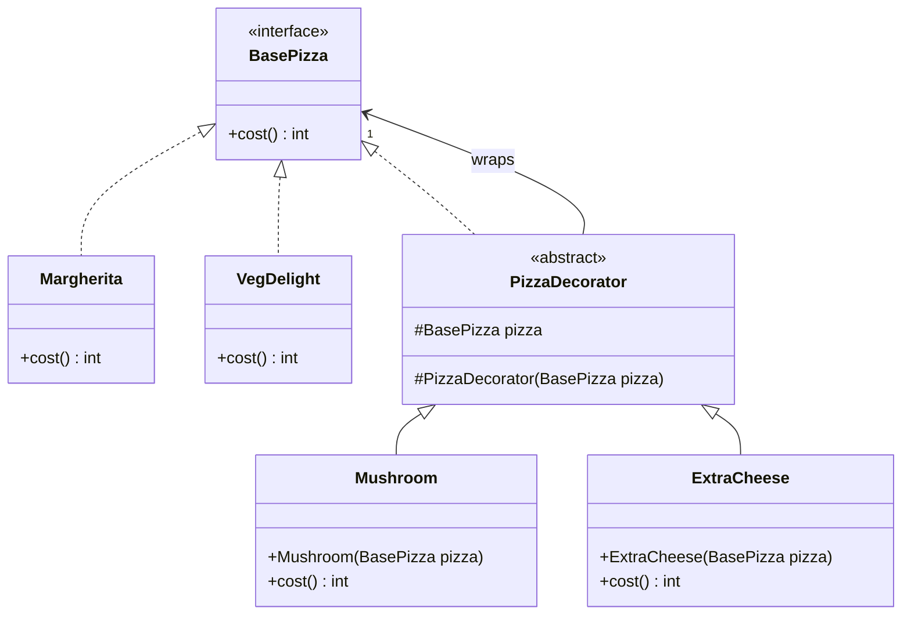
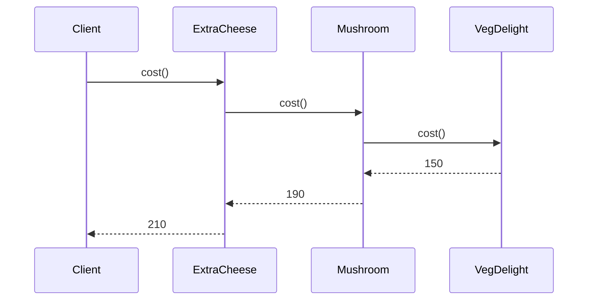

# Decorator Design Pattern

**Category:** Structural Design Pattern

## 1. Definition

The Decorator pattern dynamically adds responsibilities to an object by wrapping it inside another object that implements the same component abstraction. It provides a flexible alternative to subclassing for extending functionality.

## 2. Problem Statement

Consider a pizza ordering system with different base pizzas and optional toppings such as mushrooms and extra cheese. Creating a subclass for every possible combination leads to class explosion, duplicated logic and difficult maintenance.

## 3. Solution

- Define a common component interface for base pizzas and decorators.
- Implement concrete components with their base behaviour.
- Define an abstract decorator implementing the component contract and centralising the wrapped reference and constructor validation.
- Each concrete decorator inherits the component reference, delegates the original operation and adds its own behaviour.
- Stack decorators to combine responsibilities at runtime.

## 4. UML Class Diagram



The solid hollow triangle represents class inheritance; dashed hollow triangles represent interface implementation. Associations represent wrapped component references, without implying exclusive lifecycle ownership.

## 5. Participants

| Participant | Responsibility | Example |
|---|---|---|
| Component | Common contract | `BasePizza` |
| Concrete Component | Original behaviour | `Margherita`, `VegDelight` |
| Decorator | Shared wrapped reference and constructor validation | `PizzaDecorator` |
| Concrete Decorator | Wraps a component and extends behaviour | `Mushroom`, `ExtraCheese` |
| Client | Selects and combines decorators | `Main` |

## 6. Implementation Example

```java
public interface BasePizza {
    int cost();
}

public abstract class PizzaDecorator implements BasePizza {
    protected final BasePizza pizza;

    protected PizzaDecorator(BasePizza pizza) {
        this.pizza = java.util.Objects.requireNonNull(pizza);
    }
}

public class Mushroom extends PizzaDecorator {
    public Mushroom(BasePizza pizza) {
        super(pizza);
    }

    @Override
    public int cost() {
        return pizza.cost() + 40;
    }
}
```

The abstract decorator centralises the wrapped reference and constructor logic. `BasePizza` remains an interface because it defines a contract without requiring shared instance state. An interface-based decorator is also valid when shared implementation is unnecessary.

## 7. Execution Flow

```java
BasePizza pizza = new ExtraCheese(new Mushroom(new VegDelight()));
System.out.println(pizza.cost());
```



Each decorator delegates to its wrapped component before adding its own cost.

**Sample output:**

```text
210
```

## 8. Design Principles

- **Open/Closed Principle:** Introduce new decorators without changing existing components.
- **Single Responsibility Principle:** Each decorator encapsulates an individual responsibility.
- **Dependency Inversion Principle:** Depend on the component abstraction.
- **Composition over inheritance:** Combine behaviours through object wrapping instead of creating subclasses for every combination.

## 9. Advantages and Limitations

| Advantages | Limitations |
|---|---|
| Flexible runtime composition | Many small objects and classes |
| Avoids combinatorial subclass explosion | Deep wrapping can complicate debugging |
| Independent, reusable responsibilities | Decorator order can affect behaviour |
| Preserves the component contract | Removing an inner decorator may require rebuilding the chain |

## 10. Use Cases

- Pizza toppings and beverage customisation
- Java I/O streams, such as `BufferedInputStream` wrapping an `InputStream`
- Adding compression, encryption or logging around an operation
- UI components with optional borders or scrolling

## 11. Interview Takeaways

- A decorator both conforms to the component abstraction and wraps a component.
- A decorator can wrap another decorator, enabling recursive composition.
- **Decorator vs Strategy:** Decorator extends existing behaviour; Strategy selects an interchangeable algorithm.
- **Decorator vs Adapter:** Decorator preserves the component interface; Adapter converts an interface into another expected interface.
- An interface or abstract class can represent the common decorator type.

**Mnemonic:** Wrap, delegate, extend.

## Reference

- [Concept && Coding — Decorator Design Pattern (video reference)](https://youtu.be/w6a9MXUwcfY?si=yVtuwZhf51Ir3Jgo)
